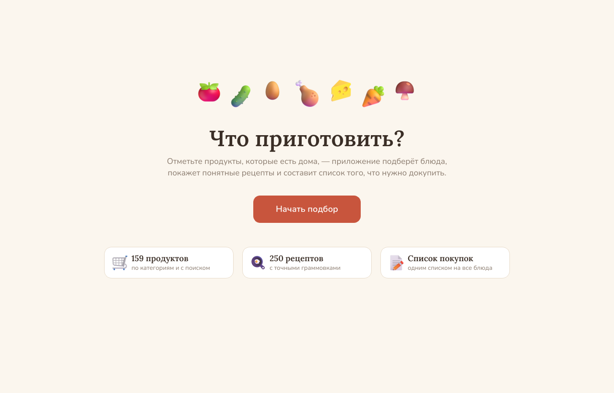
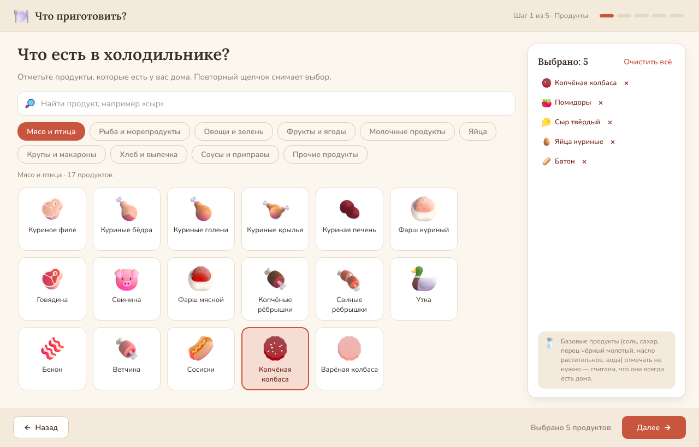
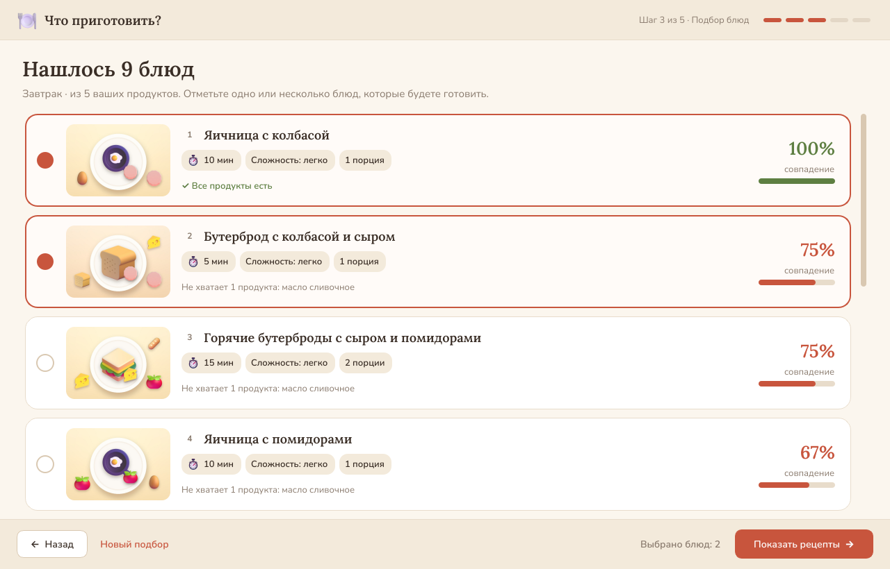
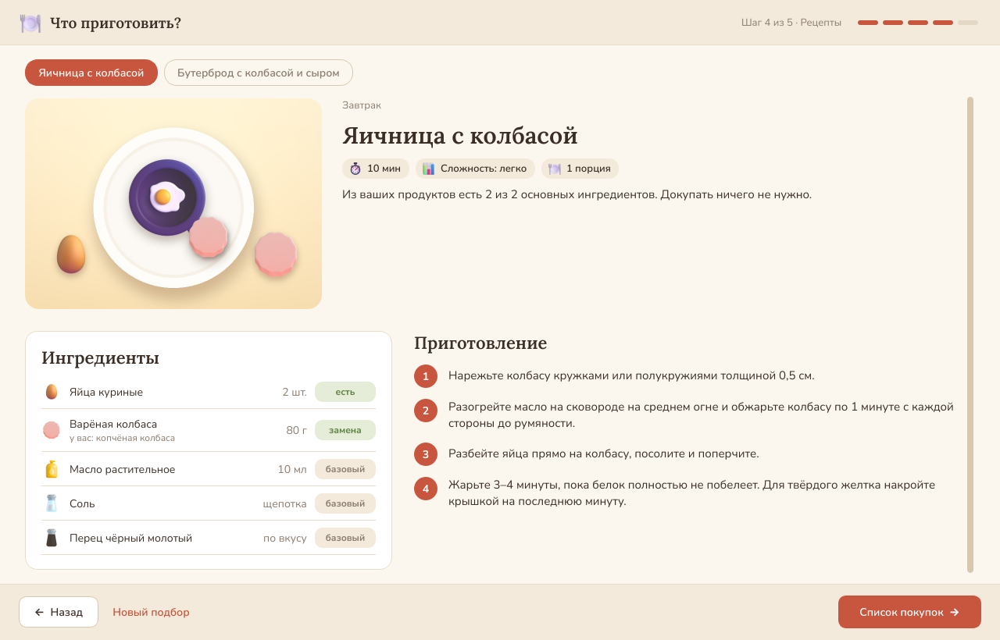
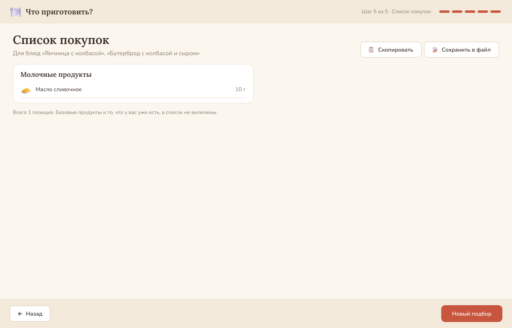

# «Что приготовить?»

Настольное приложение на Python: отмечаете продукты, которые есть дома, выбираете приём пищи — приложение
подбирает до 10 подходящих блюд, показывает понятные рецепты с точными граммовками и составляет общий
список покупок.

Учебный проект, Лапшенкова К. А., гр. ММН-26-10, НИТУ МИСИС.
Требования — в [техническом задании](docs/Техническое%20задание.docx) и [бизнес-постановке](docs/Бизнес-постановка.docx).



## Возможности

- 250 домашних рецептов: завтраки, супы, вторые блюда, салаты, перекусы, десерты
- 159 продуктов по 10 категориям, поиск по названию, у каждого продукта свой значок
- подбор по совпадению продуктов (не меньше 50 %), базовые продукты (соль, сахар, масло…) учитываются автоматически
- взаимозаменяемые продукты: батон подходит вместо белого хлеба, копчёная колбаса — вместо варёной
- несколько блюд сразу — единый список покупок, одинаковые продукты суммируются
- список покупок можно скопировать или сохранить в файл
- работает без интернета

| Выбор продуктов | Подбор блюд |
| --- | --- |
|  |  |
| **Рецепт** | **Список покупок** |
|  |  |

## Как запустить

**Готовая версия для Windows** (Python ставить не нужно): скачайте архив на странице
[Releases](../../releases), распакуйте и запустите «Что приготовить.exe».

**Из исходного кода** (Windows, macOS, Linux, Python 3.10+):

```
pip install -r requirements.txt
python main.py
```

Проверка требований ТЗ: `python tests/test_tz.py`

## Устройство проекта

| Папка / файл | Что внутри |
| --- | --- |
| `main.py` | точка входа: шрифты, стили, открытие базы данных, главное окно |
| `core/models.py` | модели данных: продукт, ингредиент, рецепт, результат подбора, позиция списка покупок |
| `core/matcher.py` | алгоритм подбора блюд (п. 3.4.1 ТЗ) и формирование списка покупок (п. 3.7 ТЗ) |
| `core/repository.py` | чтение базы данных SQLite |
| `ui/` | интерфейс на PySide6: главное окно, экраны, общие элементы, оформление «Тёплая кухня» |
| `data/products.py` | справочник продуктов: 10 категорий, 159 продуктов, 5 базовых и группы взаимозаменяемых продуктов |
| `data/recipes/` | 250 рецептов по разделам: завтраки, супы, вторые блюда, салаты, перекусы, десерты |
| `assets/cookbook.db` | база данных SQLite, собранная из `data/` |
| `assets/icons/` | значки продуктов (на основе Microsoft Fluent Emoji, MIT) |
| `assets/dish_art/` | картинки-стикеры 250 блюд в стиле значков продуктов |
| `tools/build_db.py` | собирает базу данных и проверяет, что все ингредиенты есть в справочнике |
| `tools/make_icons.py` | готовит значки: у каждого продукта свой |
| `tools/make_dish_art.py` | рисует картинки блюд: у каждого блюда своя главная картинка и значки его продуктов |
| `tools/screenshots.py` | проходит основной сценарий без экрана и сохраняет снимки (для проверки) |
| `tests/test_tz.py` | автоматические проверки требований ТЗ |
| `tools/windows/` | сборка версии для Windows: файл запуска на C, сценарий сборки |

## Алгоритм подбора (п. 3.4.1 ТЗ)

1. Берутся рецепты выбранного приёма пищи (у рецепта их может быть несколько).
2. Базовые продукты (соль, сахар, чёрный перец, растительное масло, вода) не учитываются.
3. N — число остальных ингредиентов, K — сколько из них есть у пользователя (с учётом взаимозаменяемых продуктов: батон = белый хлеб, копчёная колбаса = варёная и т. п.).
4. Соответствие S = K / N × 100 %, округление до целого.
5. Остаются рецепты с S ≥ 50 %.
6. Сортировка: по убыванию S, затем по числу недостающих продуктов, затем по времени приготовления.
7. Показываются первые 10.

Контрольный пример: «Макароны с овощами» (макароны, помидоры, огурцы, сыр + соль и масло),
у пользователя макароны, помидоры и огурцы → N = 4, K = 3, S = 75 %, не хватает сыра.

## Лицензии

- Значки — Microsoft Fluent Emoji, лицензия MIT.
- Шрифты Lora и Nunito — SIL Open Font License (файлы в `assets/fonts`).
- Картинки блюд нарисованы для проекта из значков Microsoft Fluent Emoji (MIT).
- Рецепты написаны для проекта; состав сверялся с классическими домашними рецептами.
